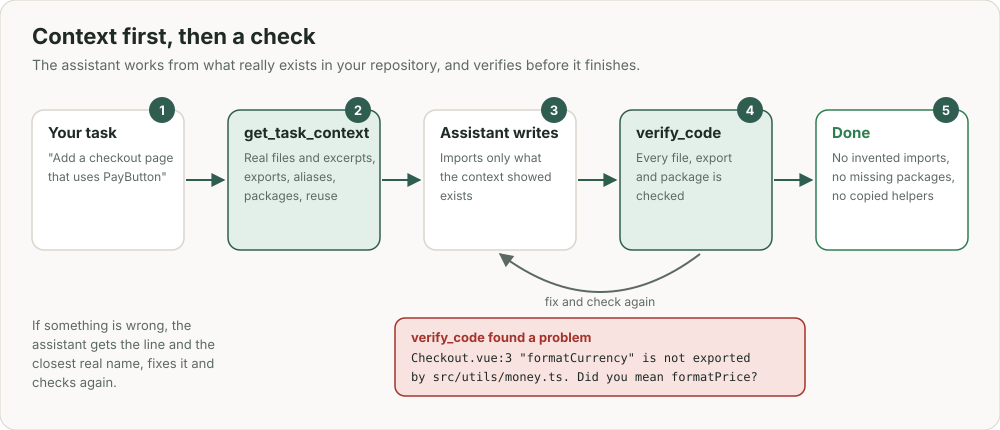

# Using codeDeft with Copilot and other AI assistants



codeDeft does not replace your AI assistant. It gives the assistant **accurate context about your repository** and **checks its code against the repository**, so it builds on files, functions and packages that really exist instead of inventing them.

It does this as an [MCP](https://modelcontextprotocol.io) server, the standard way AI assistants call external tools. GitHub Copilot (VS Code, Visual Studio, JetBrains, Copilot CLI), Claude, Cursor and others all support MCP.

## What the assistant gets

All tools are **read-only**: they never change files, so VS Code runs them without asking for confirmation.

| Tool | What it does | Hallucination it prevents |
|---|---|---|
| `get_task_context` | The relevant files (with the most relevant excerpt of each), their exports, conventions, import aliases, declared packages, import relationships and existing code to reuse, all for one task | Writing code without knowing what exists |
| `search_code` | Ranked files for a question or keywords | Guessing where something lives |
| `lookup_symbol` | Where a function, class, type or component is defined, whether it is exported, its declaration line; **closest real names** if it does not exist | Calling functions that do not exist |
| `find_reusable_code` | Existing code that already does what is needed, with usage and effort | Re-implementing what the repository has |
| `get_dependencies` | What a file imports and what imports it | Breaking callers |
| `get_conventions` | Frameworks, package manager, aliases, declared packages, detected conventions | Off-style code, wrong packages |
| `verify_code` | Checks files the assistant wrote: every imported file exists, every named/default import is really exported, every package is declared, copied code is flagged. Errors have line numbers and suggested real names | Shipping any of the above |

The server also sends **instructions** (fetch context first, never guess, verify before finishing) that the assistant reads when it connects, and a prompt, **implement_with_context**, that appears as a slash command in VS Code chat.

The index is built in memory on first use and refreshed automatically when files change (a cheap file-stat fingerprint is checked on every call), so the assistant never gets stale context.

## GitHub Copilot in VS Code (automatic)

1. Build codeDeft (`npm run build`) and run the extension (open `apps/vscode-extension`, press F5), or install the packaged extension.
2. Open your repository.
3. In Copilot Chat, choose **Agent** mode and open the tools picker: **codeDeft** is listed. Make sure it is ticked.
4. Ask as usual, e.g. "Add a checkout page using the existing pay button". Copilot calls `get_task_context`, writes the code, and calls `verify_code`.

This uses VS Code's MCP server registration API (VS Code 1.101 or newer). It needs `node` 22.13+ on your PATH; set `codedeft.nodePath` if it is elsewhere.

Optional: run **codeDeft: Connect AI Assistants › Tell Copilot to use codeDeft**. It adds a short, marked section to `.github/copilot-instructions.md` (your other instructions are kept; running it again only refreshes that section), so every Copilot request is reminded to use the tools.

Older VS Code, or teammates without the extension: **codeDeft: Connect AI Assistants › Add codeDeft to .vscode/mcp.json** writes:

```json
{ "servers": { "codedeft": { "type": "stdio", "command": "node", "args": ["<path>/codedeft-mcp.mjs"], "env": { "CODEDEFT_REPOSITORY": "${workspaceFolder}" } } } }
```

## Other assistants

**codeDeft: Connect AI Assistants › Other assistants** copies this to the clipboard (with the right paths):

```json
{ "mcpServers": { "codedeft": { "command": "node", "args": ["/path/to/codedeft-reuse-product/apps/mcp-server/dist/codedeft-mcp.mjs"], "env": { "CODEDEFT_REPOSITORY": "/path/to/your/repo" } } } }
```

Paste it into, for example, Claude Desktop's `claude_desktop_config.json`, Cursor's `.cursor/mcp.json`, or Copilot CLI's `~/.copilot/mcp-config.json`. Without `CODEDEFT_REPOSITORY`, codeDeft uses the workspace folders the assistant reports (MCP roots), then the folder it was started in.

From a terminal: `npm run mcp` (stdio; for MCP clients, not for typing into).

## codeDeft's own generation

The dashboard's and the extension's **Generate proposal** (with `CODEDEFT_ENDPOINT`/`CODEDEFT_MODEL`/`CODEDEFT_API_KEY`) now use the same checks:

1. The prompt includes the relevant source, the declared packages and grounding rules.
2. Every generated file is verified against the repository.
3. If anything does not exist, the exact problems (with suggested real names) are sent back to the model once, and the better answer is kept.
4. The proposal shows the result: "Checked against the repository: every imported file, export and package exists", or the remaining problems. VS Code's approval dialog warns when problems remain.

## Limits

- Checks are static: they prove that referenced files, exports and packages exist, not that the code behaves correctly. Run the tests (Validate) for that.
- `export *` re-exports are followed only by name presence; such imports are reported as "not checked" rather than as errors.
- Excerpts of your code are sent to whichever model your assistant uses. Review sensitive files before using an external model.
