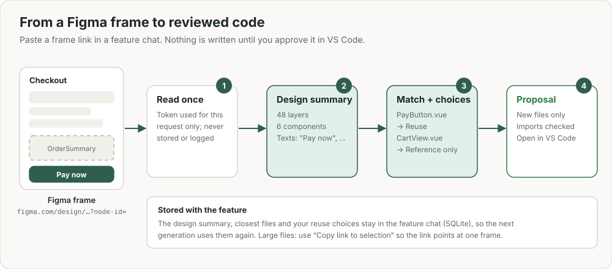

# codeDeft Figma-to-Code (v1.0)



## Setup

```bash
npm run build
npm start
```

In VS Code, open `apps/vscode-extension` and press F5 to launch the Extension Development Host. Run **codeDeft: Chat (Figma or Repository)** and type `figma`, `connect to figma`, or paste a Figma URL directly. Alternatively run **codeDeft: Read Figma Design**. codeDeft asks for the **Figma frame URL first**; if no PAT is stored, it then prompts to connect and securely enter one. Subsequent reads reuse the saved PAT. In VS Code the token is kept in `SecretStorage` and sent directly from the extension to Figma; it is never sent to the codeDeft server.

### Web dashboard

In a feature chat, paste the frame link (on its own or inside a sentence) or type `/figma`. codeDeft asks for your token; choose **Read frame**. The design summary, the closest existing files and your reuse choices are saved with the feature. Here the token **is** sent to the local codeDeft server, which uses it for that one request to Figma. It is not stored (browser or server), not logged and never included in responses or errors. The token field is cleared after a successful read and kept after a failed one so you can retry. The design stays on the server (see the README's Architecture section) and the page works with a short `designId`, so large designs do not slow the page down or hit the request limit. Generated proposals can be opened in VS Code with **Open in VS Code** for review and approval.

Use a Figma token with read access to the file. The Figma API may return 403 if permissions/scopes are insufficient.

Branch URLs (`/design/FILE/branch/BRANCH/...`) read the branch. Designs over 15,000 layers, or over the server's 4 MB request limit, are refused with a message asking you to select a single frame (use **Copy link to selection** so the URL has `node-id`).

### Analysis and generation

After reading a design, choose **Analyze** to retrieve repository evidence without calling a model. Choose **Generate Proposal** to use an OpenAI-compatible model endpoint configured on the local server:

```bash
export CODEDEFT_ENDPOINT='https://your-model-provider.example/v1/chat/completions'
export CODEDEFT_MODEL='your-model-name'
export CODEDEFT_API_KEY='your-model-api-key'
npm start
```

The model sees the normalized Figma design summary and bounded repository excerpts. Repository files are chosen using the design's names, component names and text (not its JSON layout fields). **Inspect the excerpts for secrets before using external models.** Generation produces a JSON proposal and never modifies repository files. Replies wrapped in markdown fences are accepted; `response_format: json_object` is requested and dropped automatically if your endpoint rejects it; the model timeout defaults to 180 s (`CODEDEFT_MODEL_TIMEOUT_MS`).

After **Generate Proposal** the extension offers validation **before** the approval dialog. Validation is an explicit opt-in: it copies the repository to a temporary directory, installs dependencies with `--ignore-scripts`, and runs the repository's typecheck/lint/test/build scripts there. Those scripts can execute arbitrary code, so only accept for trusted repositories.

### API

- `POST /api/figma/read` with `{url,token}` → `{designId,expiresAt,summary,warnings}` (web dashboard)
- `GET /api/figma/designs/:designId` → the stored normalized design
- `POST /api/figma/plan` with `{repository,designId}` or `{repository,design}` → design summary and retrieved repository evidence
- `POST /api/figma/generate` with `{repository,designId}` or `{repository,design}` → proposed file changes with a `proposalId`, reuse/duplication report, and explicit unknown visual/functional relevance
- `POST /api/figma/validate` with `{repository,proposal,install?}` → isolated validation report. Without `install: true` every check is reported as skipped.

All endpoints use existing loopback-only API host/origin checks and optional `CODEDEFT_TOKEN`. Do not expose this local API on the public internet.

### Not yet implemented

- Full persistent chat sidebar (a command-palette chat entry point with `figma` intent is implemented), OAuth, rendered preview, screenshot diff, automatic repair, visual relevance percentage, or native VS Code diff UI. Approved independent proposals are created by the extension; nothing else applies changes.
- The existing reusability score measures fingerprint duplication, **not** design fidelity or semantic component compatibility.

No Figma PAT is stored in the codeDeft database or repo. Disconnect with **codeDeft: Disconnect Figma**.
