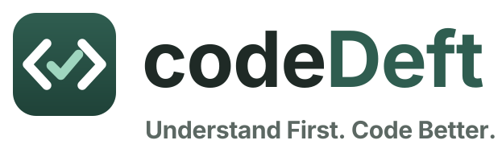
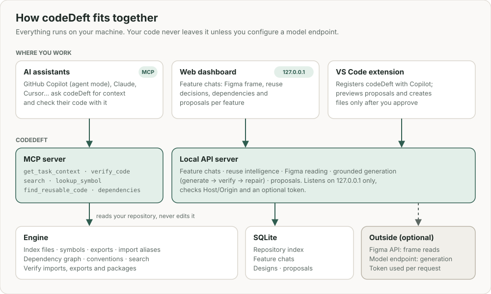
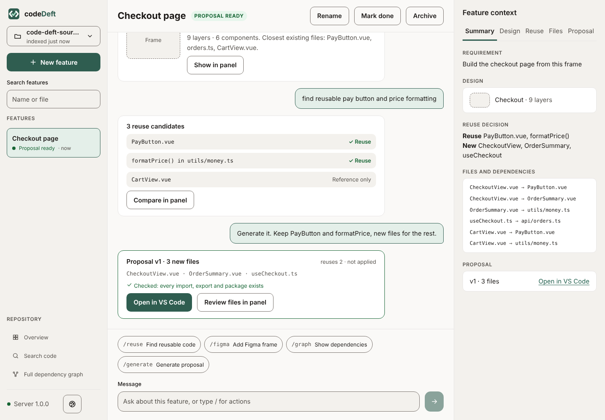

<p align="center"></p>

# codeDeft · v1.0

**Understand First. Code Better.**

A local-first repository intelligence tool: a TypeScript/SQLite engine, a local API server with a React dashboard, and a VS Code extension. It indexes a repository, answers questions with cited files, shows the import graph, finds reusable code, imports Figma designs, and generates **new-file-only** proposals that you review and approve before anything is written.





*The dashboard: one conversation per feature, saved in SQLite, with its Figma frame, reuse decisions, dependencies and proposals.*

## Use it with Copilot and other AI assistants

codeDeft's main job is to give AI assistants **correct context** so they do not hallucinate files, functions or packages. It runs as an MCP server that GitHub Copilot (agent mode), Claude, Cursor and others call: `get_task_context` before writing code, `verify_code` before finishing, plus search, symbol lookup, reuse discovery and dependencies. In VS Code the extension registers it with Copilot automatically. See **[AI_ASSISTANTS.md](AI_ASSISTANTS.md)**.

## Requirements

- Node.js **22.13+** (Node 24 LTS recommended). `node:sqlite` is used; `npm start` hides its experimental-feature notice.
- npm
- VS Code 1.90+ for the extension

## Build and run

```bash
npm run build        # engine, protocol, Figma reader, server, VS Code extension, dashboard
npm start            # http://127.0.0.1:4317
```

`npm start` runs a pre-flight check first: it refuses to start if a required part is not built and warns when a build is older than its source (the cause of blank pages and "Unknown API endpoint" errors). The server locates its files relative to itself, so it also works when started from another directory. If only the dashboard is missing, `/` explains how to build it; the API still works.

## Web dashboard

- **Feature chats.** Each feature you build is its own conversation: features in the left sidebar (search by name or file, status per feature), the conversation in the middle, and the **Feature context** panel on the right (Summary · Design · Reuse · Files · Proposal). Paste a Figma link, type `/reuse`, `/figma`, `/graph` or `/generate`, or just ask. Chats are stored in the server's SQLite database (`CODEDEFT_DB`), so they survive reloads and restarts; generation runs in the background.
- **Layout (desktop only).** ≥ 1600 px: 272 px sidebar, 400 px context panel; 1280–1599 px: 256/360 px; 1024–1279 px: the context panel opens as an overlay (**Context** button). Below 1024 px the page scrolls horizontally; phones and tablets are not supported.
- **Themes.** Light (*Paper · forest green*, the default), Dark (forest green on deep green-grey) and High contrast, or **System** (follows your OS, including *Increase contrast*). Choose with the palette button in the header, where you can also set **Text size** (100 %, 112 %, 125 %). Choices are saved in this browser.
- **Stylesheet.** `apps/web-dashboard/src/styles/`: `tokens.css` (every colour, size and motion value, per theme), `base.css` (elements and components), `layout.css` (desktop grid and breakpoints). To add a theme, copy a `[data-theme]` block in `tokens.css`, add it to `tests/theme-contrast.test.ts` and `state/preferences.tsx`; the test fails if any text or control falls below WCAG AA contrast.
- **Accessibility.** WCAG 2.2 AA target: skip link, landmarks, one heading per page that receives focus on navigation, labelled fields with hints and errors, visible focus rings, 44 px targets, status and errors announced, no information by colour alone, reduced-motion support, `Ctrl K` / `⌘ K` to jump to chat, `Esc` closes menus and the chat overlay. Checked by axe-core in the unit tests and in Chrome (including colour contrast) for every page and theme.
- **Figma token.** Paste it once per tab: with *Keep me connected in this tab* it is held in memory only (never saved; gone on reload, tab close or **Disconnect**) and forgotten automatically if Figma rejects it.

## Architecture

```
apps/mcp-server        MCP server for Copilot/Claude/Cursor: grounded context + code verification (bundled, read-only)
packages/protocol      shared contract: wire types, API version + capabilities, resilient HTTP client, chat router
packages/engine        indexing, retrieval, evaluation, validation, code verification (verify.ts), the shared path-safety rule
packages/figma-reader  Figma URL parsing, REST client, normalisation
apps/server            local API (127.0.0.1 only) + dashboard host; SQLite store for feature chats, designs and proposals
apps/web-dashboard     React dashboard: one component per view, error boundaries, vitest + jsdom tests
apps/vscode-extension  commands, review/approval flow, vscode:// proposal handoff (bundled with esbuild)
```

**Versions never crash each other.** The server reports `api.version`, `api.minClient` and a `capabilities` list at `/api/health`. The dashboard and extension negotiate once with the shared client (`packages/protocol`):
- an older server (API 1, v0.7–v0.9) is still used; features it lacks are switched off with a message saying what to update;
- a newer server is used as long as it still serves this client; new capabilities are ignored;
- only a server that needs a newer client, or no server at all, is refused, with a clear message and a retry.

Changes within an API version are additive. Every response is normalised before use, every error is an `ApiError` with a stable `code`, requests have timeouts and can be cancelled, and each dashboard panel has its own error boundary, so a malformed response or a bug in one view cannot take down the page or the extension.

**Large designs stay on the server.** `/api/figma/read` stores the normalised design in a bounded LRU cache (entry, byte and sliding-TTL budgets; content-addressed ids) and returns a short `designId`. Analysis and generation reference that id instead of re-uploading megabytes. The VS Code extension still sends designs inline, which every server version accepts.

**Dashboard → VS Code handoff.** Generated proposals are stored (random ids, bounded cache) and the dashboard shows **Open in VS Code**, a `vscode://codedeft-local.codedeft-vscode/proposal?id=…` link. The extension fetches the proposal and runs the same review-and-approve flow; it warns if the proposal was generated for a different folder. **codeDeft: Open Proposal by ID** does the same from the Command Palette. Proposals are stored in SQLite (365 days by default).

**Chat routing.** One deterministic, tested router (`routeChatMessage`) is used by both the dashboard and the extension. A Figma link anywhere in a message is extracted exactly; otherwise weighted evidence decides between reuse and search, and weak or ambiguous wording falls back to read-only search.

Open **http://127.0.0.1:4317**, click **Choose repository** (top left), enter the repository's full path and choose **Index**. Recent repositories are listed there for one-click switching. The database is stored in `data/codedeft.db` (git-ignored; override with `CODEDEFT_DB`).

### VS Code extension

1. Open `apps/vscode-extension` in VS Code and press **F5** (the folder includes `.vscode/launch.json`).
2. In the Extension Development Host, open the repository to analyze and make sure the server is running.
3. Run **codeDeft: Index Repository**, then **codeDeft: Ask Repository**, **Discover Reusable Code**, **Generate Independent Feature (Review First)** or **Chat (Figma or Repository)**.

The extension is bundled with esbuild into a single `dist/extension.js` (the Figma reader and path guard are compiled in), so `vsce package` produces a working package. It uses `http://127.0.0.1:4317` by default (`codedeft.serverUrl`).

## Configuration

| Variable | Purpose |
|---|---|
| `CODEDEFT_PORT` | Server port (default 4317) |
| `CODEDEFT_DB` | SQLite database path |
| `CODEDEFT_TOKEN` | Optional local API token; the dashboard receives it automatically, the extension needs it in `codedeft.apiToken` |
| `CODEDEFT_ENDPOINT`, `CODEDEFT_MODEL`, `CODEDEFT_API_KEY` | OpenAI-compatible chat-completions endpoint for generation |
| `CODEDEFT_MODEL_TIMEOUT_MS` | Model timeout (default 180000) |
| `CODEDEFT_JSON_MODE` | Set to `0` to stop sending `response_format: json_object` (it is also dropped automatically if the endpoint answers HTTP 400) |
| `CODEDEFT_FIGMA_API_BASE` | Figma REST base URL (default `https://api.figma.com`; HTTPS required except loopback) |
| `CODEDEFT_DESIGN_TTL_MS`, `CODEDEFT_DESIGN_CACHE_MB` | Design store lifetime (sliding, default 2 h) and memory budget (default 96 MB) |
| `CODEDEFT_PROPOSAL_TTL_MS`, `CODEDEFT_PROPOSAL_CACHE_MB` | Proposal store lifetime (default 24 h) and memory budget (default 64 MB) |

## API

- `GET /api/health` → `{ ok, version, api: { version, minClient }, capabilities }`
- `POST /api/index` `{ repository }`
- `GET /api/info?repository=…`
- `POST /api/search` `{ repository, query, limit? }`
- `GET /api/graph?repository=…&filter=…`
- `POST /api/reuse/discover`, `POST /api/reuse/decision`, `POST /api/reuse/independent/generate` — see [REUSE_INTELLIGENCE.md](REUSE_INTELLIGENCE.md) and [INDEPENDENT_REUSE.md](INDEPENDENT_REUSE.md)
- `POST /api/figma/read` `{ url, token }` → `{ designId, expiresAt, summary, warnings }`; `GET /api/figma/designs/:id`
- `POST /api/figma/plan`, `/api/figma/generate` with `{ repository, designId }` or `{ repository, design }`; `POST /api/figma/validate` — see [FIGMA_WORKFLOW.md](FIGMA_WORKFLOW.md)
- `GET /api/proposals/:id` — a generated proposal (generate responses include `proposalId`)

Errors are `{ error, code }` (`bad_request`, `unauthorized`, `forbidden`, `not_found`, `unsupported_endpoint`, `payload_too_large`, `upstream_error`, `timeout`, `internal`).

Request bodies are limited to 4 MB (HTTP 413 beyond that). Generation endpoints use the stored SQLite index when the repository has been indexed, otherwise they index it in memory.

## Evaluation

Build the engine first (`npm run build:engine`). The equations follow the codeDeft proposal:

```
CodeSim(C,R) = Σ_b ω_b [ α·S_lex + β·S_fp + γ·S_ast ]      b ∈ {template, script, style}, default α,β,γ = 0.2, 0.3, 0.5
Cov(C|K)     = |F(C) ∩ F(K)| / |F(C)|
Dup(C)       = max_K Cov(C|K) · 1[K not imported by C]
R            = 1 − Dup(C)
```

| Term | Implementation |
|---|---|
| N(x) | TypeScript scanner tokens (script), tag/attribute tokens (template), CSS tokens (style); comments and formatting removed; identifiers, strings and numbers abstracted to `ID`/`STR`/`NUM` unless `--concrete` |
| S_lex | 1 − token Levenshtein distance / max length (first 4,000 tokens per block) |
| S_fp | Jaccard similarity of winnowing fingerprints (k = 6 tokens, window 4) |
| S_ast | Weighted Jaccard of structural features: parent→child TypeScript AST node kinds, template element nesting and Vue directives, CSS property names. An approximation of normalized tree edit distance |
| ω_b | Block's share of the two files' combined tokens |
| F(·) for Dup | Fingerprints present in ≥ max(3, 20% of files) are treated as boilerplate and ignored; files with < 8 distinctive fingerprints are not judged |

Compare two files (for example, your login page and a generated one):

```bash
node packages/engine/dist/cli.js compare src/views/MyLogin.vue generated/Login.vue
node packages/engine/dist/cli.js compare a.vue b.vue --concrete --weights 0.3,0.3,0.4
```

Measure reusability of a proposal (same JSON format as `validate`):

```bash
node packages/engine/dist/cli.js evaluate /path/to/repo ./proposal.json
node packages/engine/dist/cli.js evaluate /path/to/repo ./proposal.json --db data/codedeft.db
```

Each file reports `duplication`, `reusability`, the closest repository files with their coverage, and whether each is imported. Copying `SharedDataTable.vue` into a new file (even with renamed variables) gives R ≈ 0; importing it gives no penalty.

Reference results on sample login pages: identical files 1.00, same logic with renamed variables and new text 0.90, a different implementation (Options API, reactive state) 0.26.

**Scope:** CodeSim and R measure textual and structural similarity, not behaviour. Functional correctness (F) still comes from `validate`. The weights are starting hypotheses to be calibrated against reviewer ratings. The full RAS score, architecture rules (A), pattern consistency (P) and the refinement loop are not implemented yet.

## Tests

```bash
npm run build
npm run test:all   # protocol, server (incl. API 2 end-to-end), engine, Figma reader, stores, extension, dashboard (vitest + jsdom)
```

## Security model

- The server binds to `127.0.0.1` only. Requests with a foreign `Host` (DNS rebinding) or `Origin`, and POSTs that are not `application/json`, are refused, so websites in your browser cannot use the API. `CODEDEFT_TOKEN` adds defence against other local programs and is compared in constant time.
- The server never writes into your repository. Generated code is returned as a proposal; the VS Code extension's **Approve and Create** dialog is the only way files are created, and it only creates new files (never overwrites).
- **One path rule** (`packages/engine/src/safe-path.ts`) is used by the server, the extension and CLI validation. Proposed paths must be relative, must not contain `..`, `node_modules` or any segment starting with `.` (blocking `.git`, `.vscode`, `.github`, `.husky`, `.env*`, `.npmrc` and similar), and are compared case-insensitively because macOS and Windows file systems are case-insensitive. Symlinked targets and parent directories are refused.
- Validation runs in a temporary copy. Running checks requires an explicit opt-in because it installs dependencies and runs the repository's own scripts, which can execute arbitrary code. Scripts get an allow-listed environment without API keys.
- Figma tokens: the VS Code extension keeps the token in SecretStorage and calls Figma directly. The web dashboard sends it once to the local server for the single Figma request; the server never stores, logs or returns it.
- Repository excerpts and Figma text are sent to the model you configure. Review them for secrets before using an external model. Do not expose the server to other users or networks.

## Scope and limitations

Retrieval is lexical and structural (no embeddings or FTS5 yet); reuse discovery is heuristic; reuse/extract/extend produce plans, not patches; visual fidelity of Figma output is not measured. Index each application folder separately rather than a parent folder containing several projects. See [CHANGELOG.md](CHANGELOG.md) for what changed in this release.
