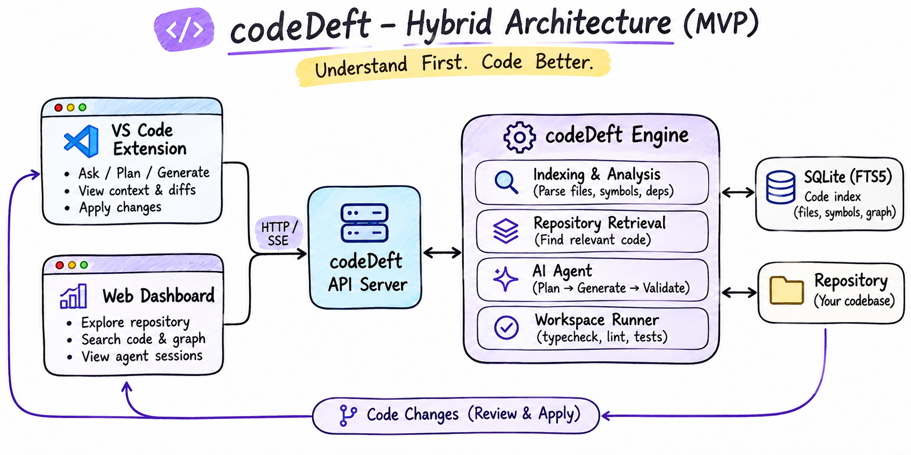

# codeDeft · v0.9

**Understand First. Code Better.**



A local-first repository intelligence tool: a TypeScript/SQLite engine, a local API server with a React dashboard, and a VS Code extension. It indexes a repository, answers questions with cited files, shows the import graph, finds reusable code, imports Figma designs, and generates **new-file-only** proposals that you review and approve before anything is written.

## Requirements

- Node.js **22.13+** (Node 24 LTS recommended). `node:sqlite` is used; `npm start` hides its experimental-feature notice.
- npm
- VS Code 1.90+ for the extension

## Build and run

```bash
npm run build        # engine, Figma reader, server, VS Code extension, dashboard
npm start            # http://127.0.0.1:4317
```

The server locates its files relative to itself, so `npm start` from the root, `npm --prefix apps/server start` and `node apps/server/dist/index.js` from any directory all work. If the dashboard has not been built, `/` returns a 503 explaining how to build it; the API still works.

Open **http://127.0.0.1:4317**, enter the absolute path of a repository and click **Index repository**. The database is stored in `data/codedeft.db` (git-ignored; override with `CODEDEFT_DB`).

### VS Code extension

1. Open `apps/vscode-extension` in VS Code and press **F5** (the folder includes `.vscode/launch.json`).
2. In the Extension Development Host, open the repository to analyze and make sure the server is running.
3. Run **codeDeft: Index Repository**, then **codeDeft: Ask Repository**, **Discover Reusable Code**, **Generate Independent Feature (Review First)** or **Chat (Figma or Repository)**.

The extension is bundled with esbuild into a single `dist/extension.js` (the Figma reader and path guard are compiled in), so `vsce package` produces a working package. It uses `http://127.0.0.1:4317` by default (`codedeft.serverUrl`).

## Configuration

| Variable | Purpose |
|---|---|
| `CODEDEFT_PORT` | Server port (default 4317) |
| `CODEDEFT_DB` | SQLite database path |
| `CODEDEFT_TOKEN` | Optional local API token; the dashboard receives it automatically, the extension needs it in `codedeft.apiToken` |
| `CODEDEFT_ENDPOINT`, `CODEDEFT_MODEL`, `CODEDEFT_API_KEY` | OpenAI-compatible chat-completions endpoint for generation |
| `CODEDEFT_MODEL_TIMEOUT_MS` | Model timeout (default 180000) |
| `CODEDEFT_JSON_MODE` | Set to `0` to stop sending `response_format: json_object` (it is also dropped automatically if the endpoint answers HTTP 400) |

## API

- `GET /api/health` → `{ ok, version }`
- `POST /api/index` `{ repository }`
- `GET /api/info?repository=…`
- `POST /api/search` `{ repository, query, limit? }`
- `GET /api/graph?repository=…&filter=…`
- `POST /api/reuse/discover`, `POST /api/reuse/decision`, `POST /api/reuse/independent/generate` — see [REUSE_INTELLIGENCE.md](REUSE_INTELLIGENCE.md) and [INDEPENDENT_REUSE.md](INDEPENDENT_REUSE.md)
- `POST /api/figma/plan`, `/api/figma/generate`, `/api/figma/validate` — see [FIGMA_WORKFLOW.md](FIGMA_WORKFLOW.md)

Request bodies are limited to 4 MB (HTTP 413 beyond that). Generation endpoints use the stored SQLite index when the repository has been indexed, otherwise they index it in memory.

## Evaluation

Build the engine first (`npm run build:engine`). The equations follow the codeDeft proposal:

```
CodeSim(C,R) = Σ_b ω_b [ α·S_lex + β·S_fp + γ·S_ast ]      b ∈ {template, script, style}, default α,β,γ = 0.2, 0.3, 0.5
Cov(C|K)     = |F(C) ∩ F(K)| / |F(C)|
Dup(C)       = max_K Cov(C|K) · 1[K not imported by C]
R            = 1 − Dup(C)
```

| Term | Implementation |
|---|---|
| N(x) | TypeScript scanner tokens (script), tag/attribute tokens (template), CSS tokens (style); comments and formatting removed; identifiers, strings and numbers abstracted to `ID`/`STR`/`NUM` unless `--concrete` |
| S_lex | 1 − token Levenshtein distance / max length (first 4,000 tokens per block) |
| S_fp | Jaccard similarity of winnowing fingerprints (k = 6 tokens, window 4) |
| S_ast | Weighted Jaccard of structural features: parent→child TypeScript AST node kinds, template element nesting and Vue directives, CSS property names. An approximation of normalized tree edit distance |
| ω_b | Block's share of the two files' combined tokens |
| F(·) for Dup | Fingerprints present in ≥ max(3, 20% of files) are treated as boilerplate and ignored; files with < 8 distinctive fingerprints are not judged |

Compare two files (for example, your login page and a generated one):

```bash
node packages/engine/dist/cli.js compare src/views/MyLogin.vue generated/Login.vue
node packages/engine/dist/cli.js compare a.vue b.vue --concrete --weights 0.3,0.3,0.4
```

Measure reusability of a proposal (same JSON format as `validate`):

```bash
node packages/engine/dist/cli.js evaluate /path/to/repo ./proposal.json
node packages/engine/dist/cli.js evaluate /path/to/repo ./proposal.json --db data/codedeft.db
```

Each file reports `duplication`, `reusability`, the closest repository files with their coverage, and whether each is imported. Copying `SharedDataTable.vue` into a new file (even with renamed variables) gives R ≈ 0; importing it gives no penalty.

Reference results on sample login pages: identical files 1.00, same logic with renamed variables and new text 0.90, a different implementation (Options API, reactive state) 0.26.

**Scope:** CodeSim and R measure textual and structural similarity, not behaviour. Functional correctness (F) still comes from `validate`. The weights are starting hypotheses to be calibrated against reviewer ratings. The full RAS score, architecture rules (A), pattern consistency (P) and the refinement loop are not implemented yet.

## Tests

```bash
npm run build
npm run test:all   # server (security, UTF-8, start-up), generation, engine, Figma reader, reuse scan, VS Code extension
```

## Security model

- The server binds to `127.0.0.1` only. Requests with a foreign `Host` (DNS rebinding) or `Origin`, and POSTs that are not `application/json`, are refused, so websites in your browser cannot use the API. `CODEDEFT_TOKEN` adds defence against other local programs and is compared in constant time.
- The server never writes into your repository. Generated code is returned as a proposal; the VS Code extension's **Approve and Create** dialog is the only way files are created, and it only creates new files (never overwrites).
- **One path rule** (`packages/engine/src/safe-path.ts`) is used by the server, the extension and CLI validation. Proposed paths must be relative, must not contain `..`, `node_modules` or any segment starting with `.` (blocking `.git`, `.vscode`, `.github`, `.husky`, `.env*`, `.npmrc` and similar), and are compared case-insensitively because macOS and Windows file systems are case-insensitive. Symlinked targets and parent directories are refused.
- Validation runs in a temporary copy. Running checks requires an explicit opt-in because it installs dependencies and runs the repository's own scripts, which can execute arbitrary code. Scripts get an allow-listed environment without API keys.
- Repository excerpts and Figma text are sent to the model you configure. Review them for secrets before using an external model. Do not expose the server to other users or networks.

## Scope and limitations

Retrieval is lexical and structural (no embeddings or FTS5 yet); reuse discovery is heuristic; reuse/extract/extend produce plans, not patches; visual fidelity of Figma output is not measured. Index each application folder separately rather than a parent folder containing several projects. See [CHANGELOG.md](CHANGELOG.md) for what changed in this release.
