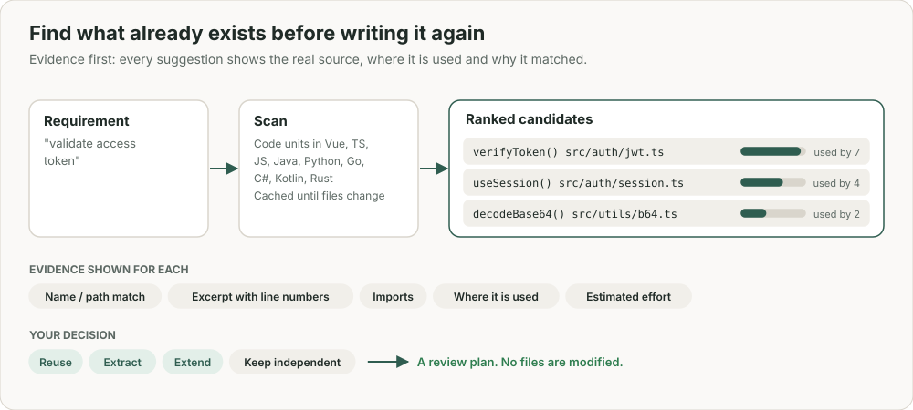

# codeDeft Universal Reuse Intelligence — MVP

This is a working **evidence-first discovery and decision review** workflow for Vue, TypeScript, JavaScript, Java, Python, Go, C#, Kotlin and Rust source files. It is **not** a verified semantic matcher or a fully automatic refactoring agent.

## Start

Build the engine, server, and extension using the commands in the root README. Start the local server, open `apps/vscode-extension` in VS Code, press F5, and run **codeDeft: Discover Reusable Code**.

Enter a requirement, choose a result, inspect the real source in VS Code, see its file path/line numbers, excerpt, imports, detected references, matching evidence and estimated effort. Choose **Reuse**, **Extract**, **Extend**, or **Keep independent**. The server produces a decision plan; no files are modified. Independent mode can optionally invoke the existing model-backed proposal generator and explicit review/approval workflow. Configure `CODEDEFT_API_KEY`, `CODEDEFT_MODEL`, and `CODEDEFT_ENDPOINT` to use generation.

## API

`POST /api/reuse/discover` body: `{ "repository": "/absolute/repo", "requirement": "validate access token", "limit": 10 }`

`POST /api/reuse/decision` body: `{ "repository": "/absolute/repo", "requirement": "validate access token", "decision": "independent", "sourceFile": "src/auth.ts", "targetFile": "src/new-auth.ts" }`

## Boundaries

- Matching uses lexical evidence and simple code-unit extraction. Scores are heuristic and do not guarantee compatibility.
- Usage tracking is approximate cross-file symbol reference search, not an accurate call graph.
- The difficulty estimate is directional, not a time estimate.
- Reuse/extract/extend produce a **review plan only**, not automatic patches.
- Independent generation is available with configured model and requires approval; imports must still be manually reviewed.
- The scan is bounded (2,500 files under 300 KB) and runs in one linear pass; results are cached per repository and reused until a source file is added, removed or changed. About 0.3 s for 1,500 files on first scan, ~50 ms afterwards. It is still synchronous, so very large repositories would benefit from a background scanner.
